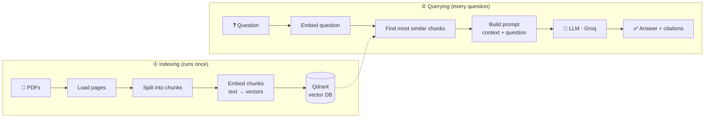
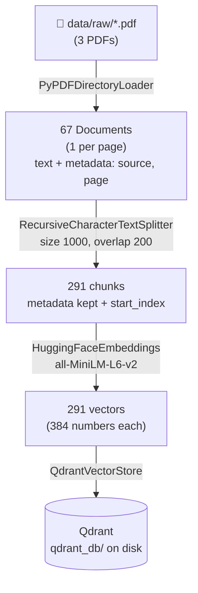
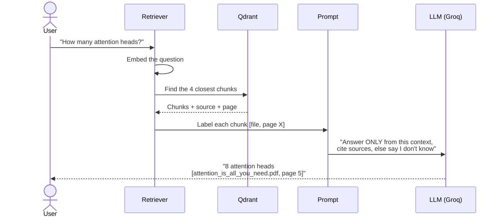
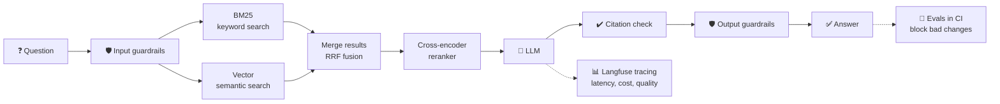

# 📄 Ask My Docs

**Ask questions about your documents in plain English and get answers with citations.**

Ask My Docs is a **Retrieval-Augmented Generation (RAG)** system, being built step by step toward a
production-grade setup: hybrid search, reranking, citation enforcement, automated evaluations,
monitoring, and deployment.

> **Status:** 🚧 In active development. The core RAG pipeline (load → chunk → embed → store → answer with citations) works.
> See the [Roadmap](#-roadmap) for what's next and [BUILD_LOG.md](BUILD_LOG.md) for a step-by-step story of how it was built.

---

## 🎯 What it does

```text
Q: How many attention heads does the Transformer use?
A: The Transformer uses 8 attention heads. [attention_is_all_you_need.pdf, page 5]

Q: Which country does Messi play for?
A: I don't know.
```

- ✅ Answers come **only from your documents**, not from the model's memory
- ✅ Every answer **cites its source** (file + page), so you can check it
- ✅ If the answer isn't in the documents, it says **"I don't know"** instead of making something up

---

## 🤔 Why RAG?

LLMs are powerful, but on their own they:

| Problem | How RAG fixes it |
|---|---|
| Don't know your private or recent documents | Retrieves the relevant parts of *your* documents at question time |
| Can confidently make things up (hallucinate) | Answers only from the retrieved text, and says "I don't know" otherwise |
| Can't tell you where an answer came from | Every answer cites the file and page |
| Retraining a model on new data is slow and expensive | Just add documents to the index; no training needed |

---

## 🏗️ How it works

RAG has two pipelines: **indexing** (prepare the documents once) and **querying** (answer each question).



### ① Indexing pipeline



| Step | What happens | Why |
|---|---|---|
| **Load** | Each PDF page becomes a `Document` (text + metadata like file name and page) | The LLM needs plain text; metadata becomes the citation later |
| **Chunk** | Pages are split into ~1000-character pieces with 200 characters of overlap, at paragraph/line boundaries | Small, focused pieces make search accurate and fit in the prompt; overlap keeps sentences at the edges from being lost |
| **Embed** | Each chunk becomes a vector of 384 numbers that captures its *meaning* | Similar meanings get similar vectors, so we can search by meaning, not just keywords |
| **Store** | Vectors + text + metadata are saved in Qdrant | Fast similarity search over many chunks, saved on disk so we don't re-embed every time |

### ② Query pipeline



The generation step is a LangChain **chain** (LCEL), where each step's output feeds the next:

```text
{context, question}  →  PromptTemplate  →  ChatGroq  →  StrOutputParser  →  "answer"
```

---

## 🎯 Target architecture (where this is heading)

The basic pipeline above is the foundation. The production version adds better retrieval,
safety checks, evaluation, and monitoring:



| Upgrade | What it adds |
|---|---|
| **Hybrid search** (BM25 + vectors, fused with RRF) | Catches exact terms (names, codes, numbers) that pure vector search misses |
| **Cross-encoder reranking** | Re-scores the top candidates more precisely, so the best chunks go to the LLM |
| **Citation enforcement** | Checks that every cited source was actually retrieved |
| **Evaluations (Ragas)** | Measures faithfulness, answer relevancy, and context precision on a test set |
| **CI quality gate** | GitHub Actions fails the build if quality, latency, or cost gets worse |
| **Observability (Langfuse)** | Traces each request: p50/p95 latency per step, cost per request, quality scores |
| **Guardrails** | Blocks prompt injection and off-topic input, keeps answers grounded |
| **API + UI + Docker** | FastAPI backend, Streamlit UI, containerized, deployed |

---

## 🧰 Tech stack

| Layer | Tool |
|---|---|
| Language | Python 3.13 |
| Framework | LangChain (LCEL) |
| PDF loading | PyPDF (`PyPDFDirectoryLoader`) |
| Chunking | `RecursiveCharacterTextSplitter` |
| Embeddings | `sentence-transformers/all-MiniLM-L6-v2` (local, free, 384 dims) |
| Vector database | Qdrant (local mode) |
| LLM | Groq, `openai/gpt-oss-20b` |
| Hybrid search | BM25 (`rank_bm25`) + vector, merged with RRF (`EnsembleRetriever`) |
| Reranker | `cross-encoder/ms-marco-MiniLM-L-6-v2` |
| API | FastAPI + Pydantic |
| *Planned* | React, Ragas, Langfuse, Docker, GitHub Actions |

---

## 📁 Project structure

```text
ask-my-docs/
├── app/
│   ├── ingest/
│   │   ├── loader.py      # PDFs → Documents (one per page)
│   │   ├── splitter.py    # Documents → chunks
│   │   └── indexer.py     # chunks → embeddings → Qdrant (build / load)
│   ├── retrieve/          # (planned) hybrid search + reranking
│   └── generate/
│       └── chain.py       # prompt + LLM chain, answers with citations
├── data/raw/              # source PDFs (not committed)
├── evals/                 # (planned) evaluation datasets + scripts
├── tests/                 # step-by-step checks for each stage
├── BUILD_LOG.md           # what was built at each step, and why
└── README.md
```

---

## 🚀 Getting started

**1. Clone and set up**

```bash
git clone <this-repo-url>
cd ask-my-docs
python3 -m venv venv
source venv/bin/activate
pip install langchain-community langchain-text-splitters pypdf \
            langchain-huggingface sentence-transformers \
            langchain-qdrant qdrant-client langchain-groq python-dotenv
```

**2. Add your Groq API key** (free at [console.groq.com](https://console.groq.com)) to a `.env` file:

```text
GROQ_API_KEY=your_key_here
```

**3. Add PDFs** to `data/raw/`. Any PDFs work; the sample set uses three public research papers:
*Attention Is All You Need*, the original *RAG* paper, and *ReAct*.

**4. Run** (always from the project root)

```bash
python -m tests.test_loader     # check PDFs load
python -m tests.test_splitter   # check chunking
python -m tests.test_indexer    # build the Qdrant index
python -m tests.test_chain      # ask questions, get cited answers
```

---

## 🗺️ Roadmap

- [x] Load PDFs with page metadata
- [x] Chunk with overlap at natural boundaries
- [x] Embed + store in Qdrant
- [x] Answer with citations + "I don't know" for out-of-scope questions
- [x] Retriever inside a single LCEL chain
- [x] Retrieval eval: 15-question golden set, **baseline hit rate @ 4 = 47%**
- [x] Hybrid search (BM25 + vector, RRF): **hit rate 47% → 60%**
- [x] Cross-encoder reranking: **hit rate 60% → 100%** (20 candidates, 0.3 s/question)
- [x] FastAPI: `/health`, Pydantic request/response models
- [ ] `/ask` connected to the real pipeline
- [ ] React UI: Ask tab + Experiments dashboard
- [ ] Citation enforcement: structured `{claim, chunk_id}` output, then verify that each cited chunk actually supports its claim
- [ ] File hash at ingest: re-index only changed files, flag stale citations
- [ ] Conflicting sources: flag disagreements and cite both; prefer newer docs via date/version metadata
- [ ] Evaluation set + Ragas metrics
- [ ] CI quality gate (GitHub Actions)
- [ ] Langfuse tracing: latency p50/p95, cost per request
- [ ] Guardrails
- [ ] FastAPI + Streamlit UI
- [ ] Docker + deployment

---

## 💡 Lessons learned so far

- **Vector search always returns *something*.** An off-topic question ("Which country does Messi play for?") still
  retrieved a World Cup example from the RAG paper. The system needs a strict prompt now, and a score threshold
  plus evals later, so it says "I don't know" instead of guessing.
- **Metadata is what makes citations possible.** Keeping `source` and `page` on every chunk, from loading
  all the way to the prompt, is what lets the answer say `[file, page X]`.
- **Ingest once, query many.** Building the index is slow; it's done once, then loaded for every question.

📖 Full step-by-step story: **[BUILD_LOG.md](BUILD_LOG.md)**
